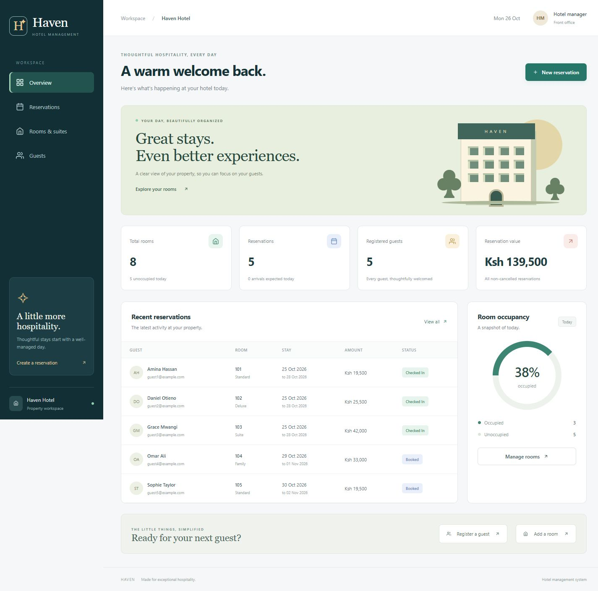

# Haven Hotel Management

A responsive hotel management workspace with deep navy, teal, sage, and warm gold colors. Built with React, Vite, Express, and optional MongoDB.



## Features

- Dashboard with reservation value, arrivals, registered guests, and date-based room occupancy.
- Room and suite management with nightly rates and capacity.
- Guest registration, editing, and search.
- Reservations with date validation, automatic totals, status updates, editing, and deletion.
- Overlap prevention with back-to-back stays allowed; cancelled and checked-out stays do not block new reservations.
- Confirmation dialogs, loading indicators, empty states, filters, and clear error messages.
- Protection against deleting guests or rooms referenced by reservations.
- Persistent local JSON storage for easy setup, or MongoDB for a database-backed installation.

## Run locally

Requires Node.js 22.12+ and npm.

```sh
npm run setup
```

Copy `backend/.env.example` to `backend/.env`. Use `DB_MODE=file` for local storage, or `DB_MODE=mongo` with your `MONGODB_URI`. Existing `.env` files are preserved and excluded from Git.

```sh
npm run dev
```

Open http://localhost:5173. The backend runs at http://localhost:5000. The Vite development proxy forwards `/api` requests to the backend.

For optional fictional demo records, run `npm run seed` with an empty local database. This command writes only to `backend/data/hotel.json` and never seeds MongoDB. It refuses to overwrite existing records.

## Production build

```sh
npm run build
npm start
```

Open http://localhost:5000. Express serves the built frontend, supports browser route refreshes, and serves `/api` from the same origin. For a separate frontend host, set `VITE_API_URL` before building and `CLIENT_ORIGIN` on the backend. Persist `backend/data` when using file storage.

This is a single-property management app for a trusted local environment. There is no user authentication, payment processing, or public guest booking portal. Add authentication and authorization before exposing operational guest data to the internet. File storage and the reservation write queue are designed for one server process; a multi-instance deployment requires a database-level reservation locking strategy.

Room availability is based on overlapping reservation dates. Room status shows occupancy today and is calculated from reservations. The occupancy metric counts active reservations covering today, rather than claiming that a future booking occupies a room now. Reservation values represent bookings, not collected payments. Currency is KES. Existing reservation totals remain fixed when only the status or guest changes; changing room or dates recalculates the amount.

## Verification

```sh
npm test
npm run lint
npm run build
```

The API integration test uses an isolated temporary file, covering room/guest CRUD, invalid input, duplicate emails, calculated totals, overlapping and adjacent dates, simultaneous booking requests, cancellation, room changes, protected deletes, missing records, and persistent storage.

## API

`GET /api/health` reports server readiness. `/api/rooms`, `/api/customers`, and `/api/bookings` support GET and POST; `/:id` supports GET, PUT, and DELETE. Booking responses include their associated guest and room.

No credentials, guest records, node_modules, or generated build files are included in the repository.


